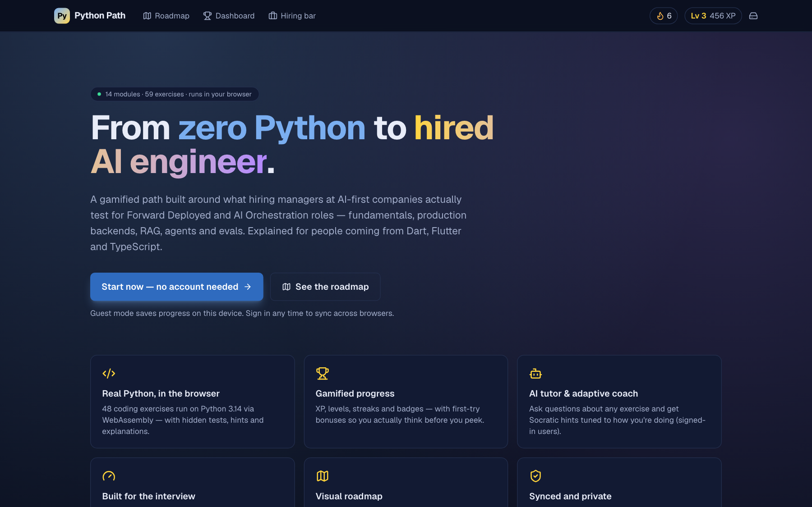
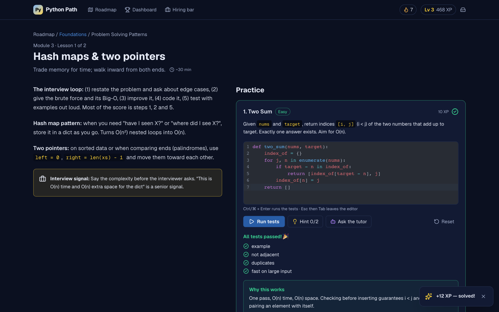
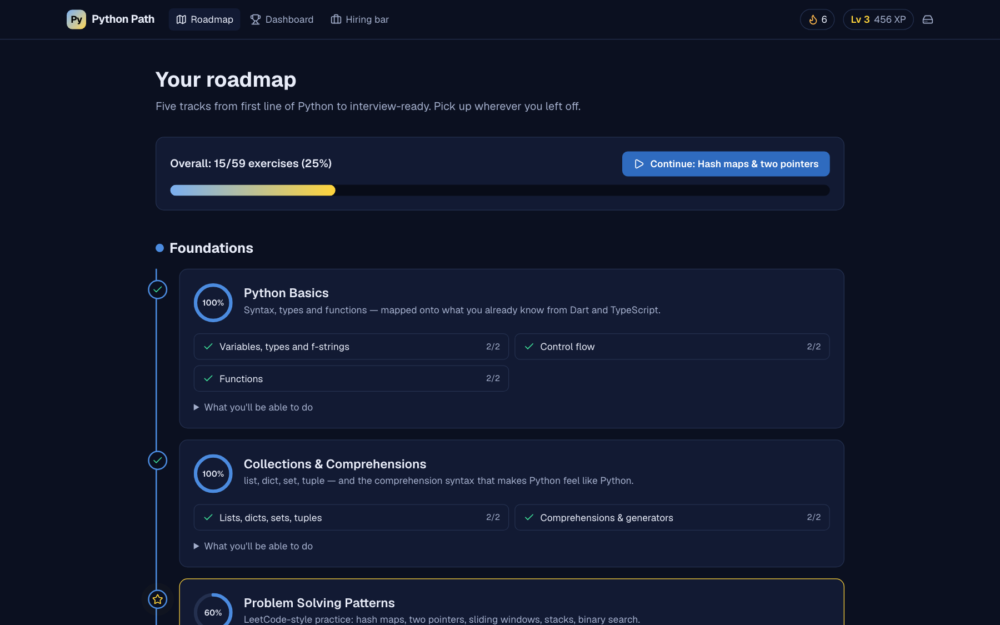
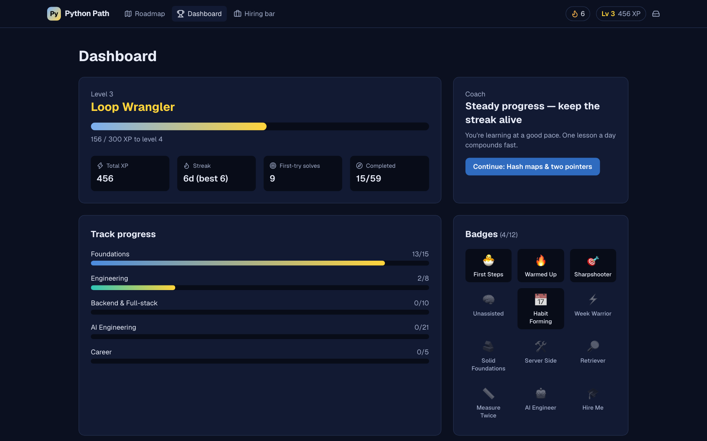
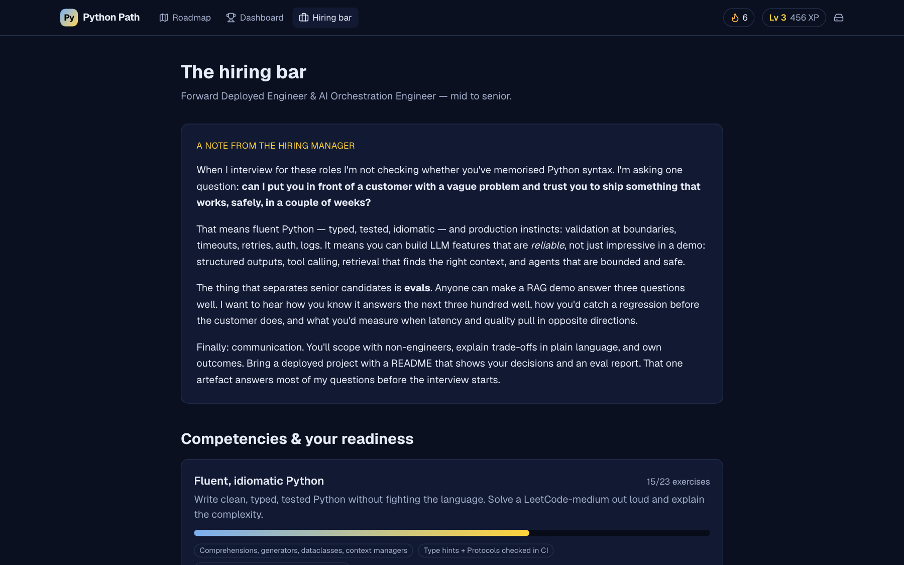
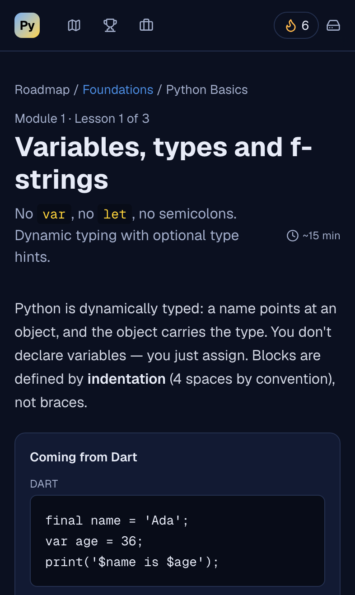
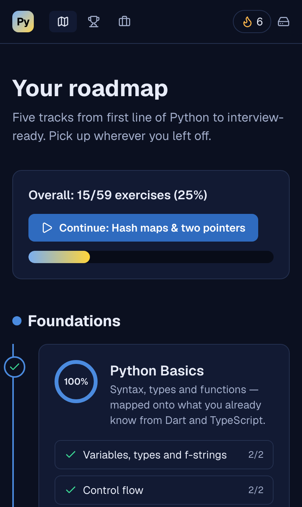
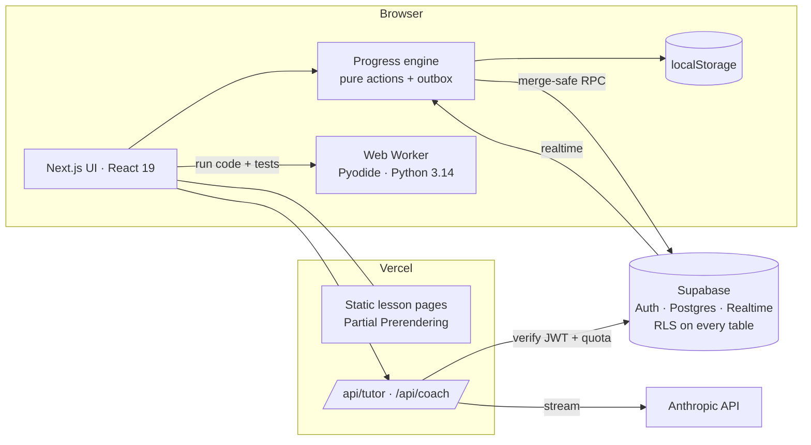

<div align="center">

# 🐍 Python Path

**From zero Python to a hired Forward Deployed / AI Orchestration Engineer — in your browser.**

A gamified learning platform that teaches Python the way AI-first companies actually hire for it:
fundamentals → production backends → RAG, agents and evals → interview prep.

[**Live demo →**](https://python-path-pi.vercel.app) · no sign-up needed (guest mode)

[](https://github.com/Jermayy/python-path/actions/workflows/ci.yml)
[](https://github.com/Jermayy/python-path/actions/workflows/security.yml)


-3776ab?logo=python&logoColor=white>)

[](LICENSE)



</div>

## Why this exists

Most "learn Python" courses stop at syntax. Senior AI-engineering roles expect much more: production APIs, retrieval that actually finds the right context, agents with guardrails, and — the real differentiator — **evals** that prove a system works. Python Path is reverse-engineered from that hiring bar, and written for developers coming from **Dart/Flutter and TypeScript**: early lessons put the Dart/TS equivalent side by side with the Python.

## Features

|                              |                                                                                                                                                                                                                                                                                                                     |
| ---------------------------- | ------------------------------------------------------------------------------------------------------------------------------------------------------------------------------------------------------------------------------------------------------------------------------------------------------------------- |
| 🧪 **Real Python, no setup** | 48 coding exercises run on CPython 3.14 compiled to WebAssembly (Pyodide) in a Web Worker — with NumPy, Pydantic and sqlite3. Visible **and hidden** tests, progressive hints, explanations, and a kill switch for infinite loops.                                                                                  |
| 🗺️ **14 modules, 5 tracks**  | Foundations → Engineering → Backend & Full-stack → AI Engineering → Career. 59 exercises including LeetCode-style patterns, a mini web framework, a NumPy vector index with ACLs, hybrid search (RRF), an agent loop, LLM-as-judge with position-swap, CI regression gates, gradient descent and fine-tune data QA. |
| 🎮 **Gamified**              | XP with first-try bonuses and hint penalties, 12 levels, streaks, 12 badges, completion toasts and a visual roadmap.                                                                                                                                                                                                |
| 🔄 **Sync across devices**   | Guest mode works offline in the browser; sign in and progress syncs **live** between browsers, conflict-free.                                                                                                                                                                                                       |
| 🤖 **AI tutor & coach**      | A Socratic tutor that sees your code and test results (streaming), plus an adaptive coach that returns a structured hint and a difficulty recommendation. Rate-limited per user.                                                                                                                                    |
| 🎯 **Hiring-bar readiness**  | Every module maps to a competency a hiring manager scores, with live readiness bars.                                                                                                                                                                                                                                |

### Learn by doing — real tests, instant feedback



### See where you are, and what's next



### Levels, streaks, badges and a coach



### Built around what hiring managers look for



### Works on your phone

<p align="center">
  
  &nbsp;&nbsp;
  
</p>

## Curriculum

| Track                    | Modules                                                                                                                                                             |
| ------------------------ | ------------------------------------------------------------------------------------------------------------------------------------------------------------------- |
| **Foundations**          | Python Basics · Collections & Comprehensions · Problem Solving Patterns (hash maps, two pointers, sliding window, stacks, binary search)                            |
| **Engineering**          | Idiomatic Python (dataclasses, exceptions, generators, decorators) · Types, Tests & Tooling (Protocols, pytest, uv, ruff)                                           |
| **Backend & Full-stack** | Data, SQL & APIs (Pydantic, parameterised SQL, REST) · Async & Reliable Integrations · Python backends for TS frontends (auth tokens, cursor pagination, CORS, SSE) |
| **AI Engineering**       | LLM Foundations · Embeddings, Vectors & RAG · Agents & Orchestration · Evals · Model Training & Fine-tuning                                                         |
| **Career**               | Production, Interviews & Capstone (observability, cost, FDE system design)                                                                                          |

## Architecture



More detail in [docs/architecture.md](docs/architecture.md) and the [ADRs](docs/adr).

## Engineering highlights

- **Learner code never touches a server.** Python runs in a sandboxed Web Worker; runaway code is terminated after 15 s and the runtime restarts ([ADR 0002](docs/adr/0002-in-browser-python-with-pyodide.md)).
- **The curriculum is tested like code.** CI loads the same Pyodide runtime in Node and asserts that every reference solution passes all of its tests and every starter fails — 96 runtime checks across 48 exercises. A broken exercise can't ship.
- **Conflict-free sync.** Progress is stored as facts and merged with commutative, idempotent rules (a state-based CRDT), mirrored exactly in a Postgres function — two devices offline at once still converge. XP and badges are _derived_, so changing the formula never needs a migration ([ADR 0004](docs/adr/0004-progress-sync-model.md)).
- **Local-first, offline-tolerant.** Writes land in localStorage synchronously, then flush from a persisted outbox with exponential backoff; Supabase Realtime pushes changes to other open sessions.
- **AI with guardrails.** Calls are gated cheapest-first: same-origin + JSON → verified JWT → zod validation → atomic per-user daily quota in Postgres → model. Learner content is delimited and treated as data; the model has no tools. Structured output is schema-validated ([ADR 0005](docs/adr/0005-ai-tutor.md)).
- **Secure by default.** Row Level Security on every table, CSP and security headers, RFC 9457 error responses without internals, open-redirect protection, redacted structured logs. Threat model and risk-rated findings in [docs/security-review.md](docs/security-review.md).
- **Accessible.** Automated axe checks (WCAG 2.2 AA) in light _and_ dark mode in CI, keyboard-operable editor, visible focus, screen-reader labels, reduced-motion support.
- **CI that fixes itself — within limits.** When a PR fails CI or security scans, an AI agent rates each finding by risk and effort and proposes a fix; a _deterministic_ step enforces ≤ 100 changed lines, blocks protected paths (auth, migrations, workflows), re-runs checks and only then pushes ([ADR 0006](docs/adr/0006-ci-autofix.md)).

## Tech stack

| Layer          | Choice                                                                                                  |
| -------------- | ------------------------------------------------------------------------------------------------------- |
| Front end      | Next.js 16 (App Router, Cache Components, React Compiler), React 19, Tailwind CSS 4, CodeMirror 6       |
| Python runtime | Pyodide 314.0.7 (CPython 3.14 → WebAssembly) in a Web Worker                                            |
| Data & auth    | Supabase — Postgres with RLS, Auth, Realtime                                                            |
| AI             | Anthropic Claude (`@anthropic-ai/sdk`), streaming + structured outputs                                  |
| Validation     | zod (TypeScript), Pydantic (inside exercises)                                                           |
| Testing        | Vitest (unit + Pyodide content tests), Playwright (e2e, mobile, axe)                                    |
| CI/CD          | GitHub Actions (lint, types, tests, build, e2e, gitleaks, npm audit, CodeQL, dependency review), Vercel |

## Quality

- **119** unit and content tests · **27** end-to-end tests (desktop, mobile, accessibility, security headers, API guards)
- TypeScript `strict`, ESLint with zero warnings, Prettier, all enforced in CI
- `main` is protected: changes only via PR with green checks and no high-severity code-scanning alerts

## Getting started

Requires Node 24 (pinned in `.nvmrc`).

```bash
git clone https://github.com/Jermayy/python-path.git && cd python-path
npm ci
npm run dev            # http://localhost:3000 — runs in guest-only mode with no env vars
```

To enable accounts and the AI tutor, copy [.env.example](.env.example) to `.env.local`, add Supabase and Anthropic keys, and apply [`supabase/migrations`](supabase/migrations).

| Command               | What it does                                                             |
| --------------------- | ------------------------------------------------------------------------ |
| `npm run dev`         | Dev server                                                               |
| `npm run check`       | Format check, lint, typecheck, unit + content tests, build (the CI gate) |
| `npm test`            | Unit tests + content tests (runs every exercise in Pyodide)              |
| `npm run test:e2e`    | Playwright suite (run `npm run build` first)                             |
| `npm run screenshots` | Regenerates the images in this README (run `npm run build` first)        |

## Project structure

```
src/
  app/                  routes: landing, roadmap, dashboard, learn/[module]/[lesson], login, api/*
  components/           UI: exercise cards, tutor panel, header, progress primitives
  modules/
    curriculum/         content + types (pure data)
    runner/             Python test harness + Pyodide worker client
    progress/           actions, CRDT merge, gamification, coach, sync engine
    tutor/              AI schemas, prompts, Anthropic adapter, request guard
  shared/               config, logger, HTTP helpers, Supabase clients
public/workers/         Pyodide Web Worker
supabase/migrations/    schema, RLS policies, RPCs
tests/{unit,content,e2e}
docs/                   architecture, ADRs, security review, screenshots
```

## Roadmap

- Self-host the Pyodide build (remove the third-party CDN from the trust boundary)
- Self-service account deletion and an error tracker
- AI-generated "trending skills" updates to the curriculum
- Capstone project track with a deployed RAG service and eval report

## Contributing & security

Changes go through pull requests with green CI. Please report vulnerabilities privately — see [SECURITY.md](SECURITY.md).

Built with AI pair-programming (Claude Code); every change went through review, CI and the same quality gates described above.

## Licence

[MIT](LICENSE)
