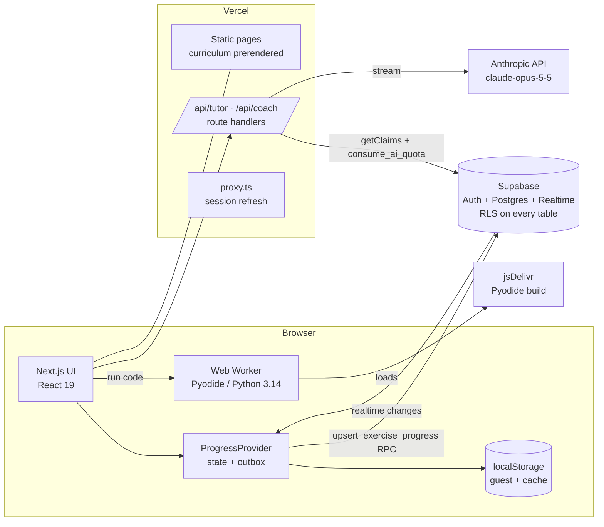

# Architecture

Python Path is a **modular monolith**: one Next.js 16 app (App Router, Cache Components) on Vercel, with Supabase for auth and progress storage and Anthropic for the optional AI tutor.

## Modules (`src/modules`)

| Module       | Responsibility                                                                                |
| ------------ | --------------------------------------------------------------------------------------------- |
| `curriculum` | Pure data: modules → lessons → content blocks + exercises (with tests, hints, solutions).     |
| `runner`     | Python harness (shared with tests), Pyodide worker client with timeouts and restart.          |
| `progress`   | Facts (`ExerciseProgress`), pure actions, CRDT-style merge, gamification, coach, sync engine. |
| `tutor`      | Request schemas, prompts, Anthropic adapter, auth/CSRF/quota guard for AI routes.             |

`src/shared` holds config (validated with zod), logging (JSON + redaction), HTTP helpers (RFC 9457) and Supabase clients.

## Data flow: completing an exercise

1. Worker runs learner code + tests; returns per-test results.
2. `recordAttempt` (pure) produces the new state; `commit` writes it to React state **and localStorage synchronously**.
3. For signed-in users the record is added to a persisted **outbox**, then flushed via the `upsert_exercise_progress` RPC.
4. The RPC merges with the same rules as `merge.ts` (completed wins, max attempts/hints, earliest completion, newest code), so concurrent devices converge.
5. Supabase Realtime pushes the row to other open sessions, which merge it in.

XP, levels, streaks and badges are **derived** from the stored facts — never stored — so changing the XP formula never requires a migration.

## Key decisions

See [docs/adr](adr/).
